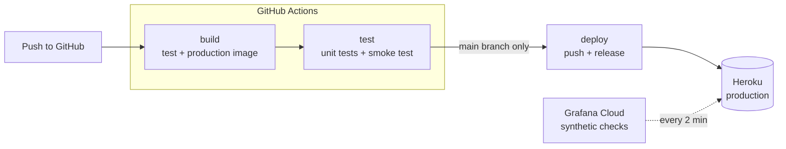
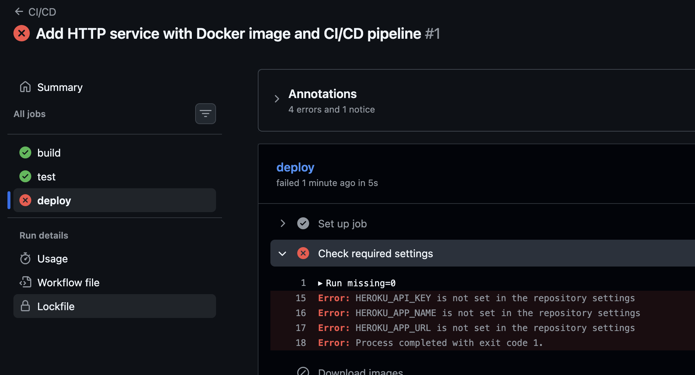

# Specification: DevOps Homework

This specification document describes how I would approach solving the homework: a production service where every change goes through a CI/CD pipeline and is automatically deployed to production. I have 
also created a minimum viable setup, deployed on Heroku and monitored with Grafana Cloud Synthetic Monitoring.

**Live service:** <https://celtra-homework-0d0b6b4c5457.herokuapp.com/demo/data>

Example of returned data:
```json
{
  "accountId": "demo",
  "timestamp": "2026-11-11T15:47:51Z",
  "data": "cd1d6bea-3e50-40a2-8c98-aefb32f5ac48"
}
```

---

## Approach

After reading through the instructions, I made a general plan on how to do each step and what to use. I also researched the pricing for deployment.

When I had the general idea on how to go about it, I started working and made sure each step worked, before moving on to the next one.

1. **Create an HTTP service**: ran the service and the tests locally.
2. **Create a Docker image**: built the image and ran both the tests and the service inside the containers.
3. **CI step**: pushed to GitHub and checked that build and test steps passed on GitHub's runners.
4. **CD step**: configured Heroku and checked that a push to `main` ended up in production.

For the platform I chose Heroku for this minimal setup, because I have deployed to it before.

### Overview

`build`, `test`, `deploy` are the three steps in CI/CD I made; in `build` both the test and production image get built, in `test` the unit tests and the smoke test for the production image are run, and in `deploy`, the production image is pushed to Heroku. (ran when pushed to `main` branch).



## Steps I took
## Step 1: HTTP service

### What it does
`GET /<accountId>/data`, returns:

| Field | Value |
|---|---|
| `accountId` | taken from the URL path |
| `timestamp` | current time in UTC, ISO 8601, e.g. `2026-11-11T13:34:00Z` |
| `data` | a random UUID, different on every request |

### Decisions
- **Python with Flask.** I chose Flask for its simplicity, though I generally have experience with Pyramid. With more complexity, I would consider that or FastAPI.
- **Timestamp in ISO 8601** A widely used and readable format. 
- **UUID for the random string.** Something that is simple to integrate and changes on every request.

### Tests
I added 8 unit tests. They check:
- status 200 and a JSON response
- endpoint returns exactly the three expected fields
- `accountId` is taken from the path
- `timestamp` is the current (frozen) time, in UTC and ISO 8601 format
- `data` is a valid UUID and differs between requests
- unknown paths return 404 and other methods (e.g. POST) return 405

### Documentation
- [Flask quickstart](https://flask.palletsprojects.com/en/stable/quickstart/): 
- [pytest documentation](https://docs.pytest.org/en/stable/): 

---

## Step 2: Docker image

### Multi-stage Dockerfile

| Stage | Contents | Used for |
|---|---|---|
| `base` | `python:3.13-slim`, runtime dependencies, app code | shared by both stages below |
| `test` | `base` + pytest + tests; runs pytest by default | CI only |
| `runtime` | `base` + non-root user; runs gunicorn | production |

### Decisions
- **Test and runtime stages share the same base.** The tests run against exactly the same code and dependencies that ship to production, while pytest and the tests never end up in the production image.
- **Separate runtime and dev dependencies** (`requirements.txt` and `requirements-dev.txt`), for the same reason; a smaller production image with fewer packages that could contain vulnerabilities.
- **Non-root user.** The app doesn't need root, so following least privilege it runs as a normal user. This limits the damage if the app were ever compromised.


### Documentation
- [Docker multi-stage builds](https://docs.docker.com/build/building/multi-stage/): building the test and runtime images from one Dockerfile.
- [Docker build best practices](https://docs.docker.com/build/building/best-practices/): layer caching, slim base images, non-root user, `.dockerignore`.

---

## Step 3: CI

The pipeline is a GitHub Actions workflow in `.github/workflows/ci-cd.yml`. It runs on every pull request and on every push to `main`.

### Job `build`
- Builds the test image and the production image.
- Builds the production image for `linux/amd64`, the architecture Heroku runs.
- Saves both images to a file and uploads it as a workflow artifact.

### Job `test`
- Downloads the images from the artifact.
- **Unit tests:** runs the test image, which runs pytest.
- **Smoke test:** starts the **production** image, waits until it answers (up to 10 seconds), calls the endpoint and checks the response. If it fails, a separate step prints the container logs.

### Decisions
- **Added a smoke test.** The smoke test checks the deployable artifact. For example, gunicorn missing from `requirements.txt` would pass the unit tests but fail the smoke test, before reaching production.
- **Actions pinned to commit SHAs** Prevents a software supply chain attack through moving the tag.


### Documentation
- [Workflow syntax for GitHub Actions](https://docs.github.com/en/actions/using-workflows/workflow-syntax-for-github-actions)
- [Storing workflow data as artifacts](https://docs.github.com/en/actions/using-workflows/storing-workflow-data-as-artifacts)
- [Security hardening for GitHub Actions](https://docs.github.com/en/actions/security-guides/security-hardening-for-github-actions)

---

## Step 4: CD

### Job `deploy`
1. **Check required settings.** Fails immediately with a clear message if the Heroku API key, app name or app URL is missing.
2. **Load the tested images** from the artifact.
3. **Log in to Heroku's container registry.** 
4. **Push the tested production image** to `registry.heroku.com/<app>/web`.
5. **Release.** Reads the image's digest from Heroku's registry and calls the Heroku Platform API to run it as the `web` process.
6. **Check production after deploy.** Calls the live URL until it answers (up to about a minute), and fails the job if it doesn't.





### Decisions
- **Credentials in a GitHub environment (`production`).** The Heroku API key is a secret in the `production` environment, so only the deploy job can read it.
- **A separate Heroku token** created for GitHub Actions (`heroku authorizations:create`) instead of my account's main API key, so it can be revoked on its own.
- **`concurrency: production`.** Two deploys never run at the same time; a newer one waits for the older one to finish.

### Documentation
- [Heroku Container Registry & Runtime](https://devcenter.heroku.com/articles/container-registry-and-runtime): the container stack, pushing to `registry.heroku.com`, `$PORT`, linux/amd64.
- [Heroku Platform API: Formation](https://devcenter.heroku.com/articles/platform-api-reference#formation): releasing an image as the `web` process.
- [Using environments for deployment](https://docs.github.com/en/actions/deployment/targeting-different-environments/using-environments-for-deployment): environment-scoped secrets.
- [Heroku usage and billing](https://devcenter.heroku.com/articles/usage-and-billing): dyno costs.

---

## Observability

### Uptime monitoring with Grafana Cloud Synthetic Monitoring
An HTTP check calls `/uptime-check/data` on production. It has 2 probes (US and Europe), and probes every two minutes.

In a bigger project, we could use OpenTelemetry with Prometheus. We could then build dashboards, metrics, SLOs and alerts. 


### Logs
Added a SolarWinds Papertrail Add-on to the Heroku app.


### Documentation
- [Grafana Synthetic Monitoring: HTTP checks](https://grafana.com/docs/grafana-cloud/observe-and-act/testing/synthetic-monitoring/create-checks/checks/http/)

---

## Known limitations

- **Single dyno** If it crashes, restarts, or is replaced during a deploy, the service is briefly unavailable. A production setup with an SLA needs more than one instance with a load balancer.
- **No staging environment.** Changes go straight from CI to production.


---

## Further improvements

1. Automatic rollback when the post-deploy check fails (on Heroku: `heroku releases:rollback` in a failure step).
2. Staging environment with promotion of the same image to production (on Heroku: a second app and a Pipeline).
3. Automated dependency updates (Dependabot or Renovate) for Python packages, the base image and the pinned action SHAs.
4. Locked dependencies with `pyproject.toml` and a lock file (e.g. uv), so transitive dependencies are pinned too.
5. Application metrics (request rate, errors, latency) exposed for Prometheus.
6. A runbook linked from each alert, describing the first steps when it fires.
7. A notification system for CI/CD in e.g. Slack, so we can be notified there if a workflow failed.
8. Using hardened images, docker compose, E2E tests.

## LLM usage

I consulted an LLM (Claude) on parts of the homework; in steps that weren't as clear to me (the Docker image step as I haven't done it in a while, setting up Grafana, debugging deployment/Heroku issues), and for setting up the bones of the project.
